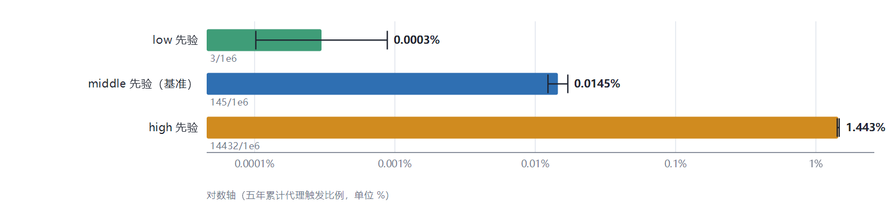
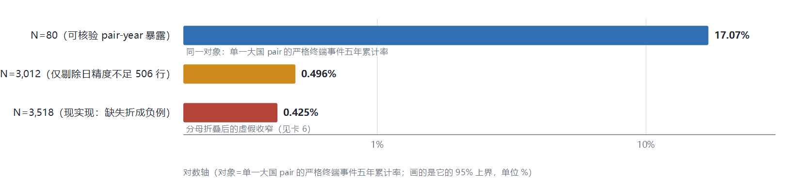
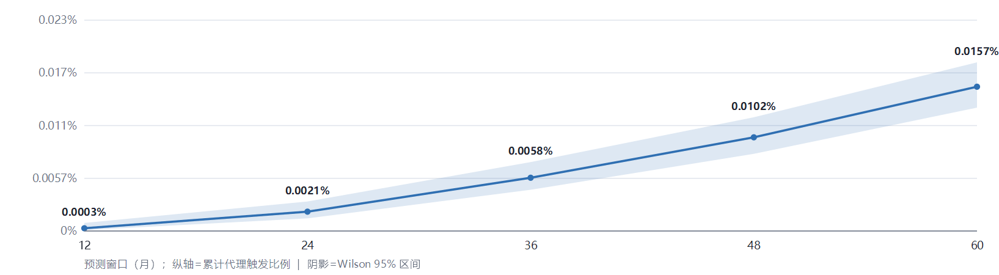
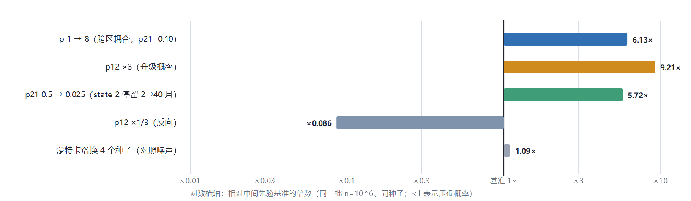
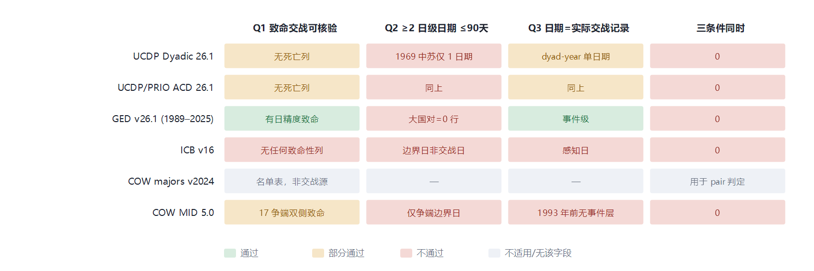
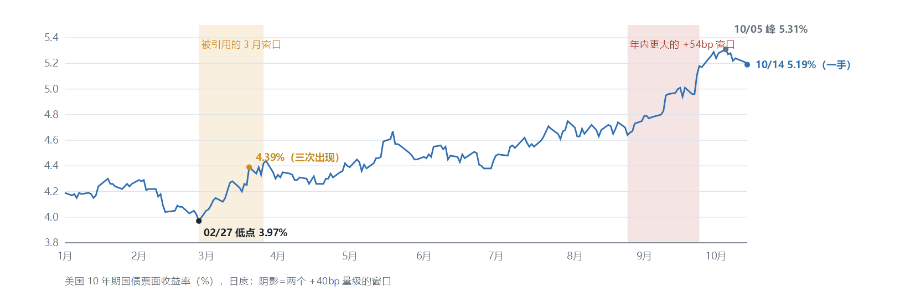

# WW3 五年风险模型 — 代理事件模拟结果与可识别性报告

> **本仓库是「报告 + 可复现依赖」的快照，不是模型实现**：`label_status` 三态（P0）未实现，下面任何数字都未经历史校准。定稿快照直链：<https://rainchai455-cy.github.io/ww3prediction/ww3_final_simulation_report_2026-10-15.html>

> **本文件由 `_readme_build.py` 从同目录 `index.html` 机械转换生成**（图经 ImageMagick/RSVG 栅格化为 `assets/figN.png`）。

> 不要手改正文数字：改 `_report_build.py` → 重建 `index.html` → 重跑本脚本；逐文件哈希与复现命令见 `MANIFEST.md`。

> 同一份内容的网页版：<https://rainchai455-cy.github.io/ww3prediction/>

预测窗口 2026-10-15 → 2031-10-15 ｜ 生成于 2026-10-16 02:26 ｜ n = 106 路径／情景，H = 60 个月，5 个区域态，基准种子 20261015（每个 run 的种子逐行列在表内）

> **读数前提（不可省略）**：本报告只有一个可报告对象——**代理事件**（模拟器判据：滚动 3 个月记忆内 ≥2 个区域处于 state 2）的**先验条件触发比例**。 它**不是**"真实 WW3 的五年发生概率"。真实 WW3 的五年概率在本模型中**没有被估计，也不可识别**：模型里没有严格终端层（≥2 个日级日期、≤90 天、双侧致命、同一升级事件、双方可核实），而六个历史来源提供的可核验正例为 **0**（Q1 部分通过／Q2 不通过／Q3 不通过），闸门已于 2026-10-15 关闭。 因此蒙特卡洛跑 106 次只是把先验假设采样得很精确，不会把它变成历史校准；`0→1` 层也只能说"危机起始标签可观测"，不等于完成概率校准。

### 正式摘要（只写三件事）

1. **模拟输出**：在人为设定的三档先验与代理判据下，五年累计**代理触发比例**分别为 0.0003%、0.0145%、1.4432%（每档 106 条路径，命中 3／145／14,432）。这是"代理事件的模拟概率"，**不是**"真实 WW3 的五年发生概率"。
2. **可识别性**：经审计的六类历史来源没有提供满足严格终端定义的可验证正例，因此目前无法从这些资料估计可靠的真实 WW3 五年发生概率。零正例上界 17.07% 约束的是"单一大国 pair 的严格终端五年累计率"，与上面三条不是同一个估计对象，故不参与任何倍数比较。
3. **决策含义**：p12（×3 ⇒ ×9.21）、state 2 停留时长（p21 0.5→0.025 ⇒ ×5.72）与跨区耦合 ρ（1→8 ⇒ ×6.13）都会显著改变输出，且全部远大于换随机种子的散布 1.095×；因此**任何单一结果都不应作为经历史校准的风险数字使用**。

> **升级前提**：在 P0（三态标签把"确认发生／确认未发生／证据不足"严格分开，修掉缺失值被转成 `False`）以及当前状态证据审核（P1-c）、时间外验证（P1-b）完成之前，本报告的分层结论与曲线**不升级为现实风险预测**。继续扩充模拟不是下一步。

## L3 先验 ｜ 1. 模拟输出：代理事件的五年累计触发比例（三档先验）

判据为模拟器的**代理规则**：滚动 3 个月记忆内 ≥2 个区域处于 state 2。区间是 Wilson 95%，只含蒙特卡洛抽样误差，不含先验不确定性。

| 值 | 含义 |
|---|---|
| **0.0145%** | 中间先验：五年至少一次代理触发（145/106） |
| **0.0123% – 0.0171%** | 其 Wilson 95% 区间（仅蒙特卡洛抽样误差） |
| **4811×** | low ↔ high 先验跨度（同一判据同一单位 ⇒ 可比） |
| **未估计** | 真实 WW3 的五年发生概率（模型无严格终端层，历史 0 正例） |

| 先验档 | 五年累计代理触发 P | Wilson 95% | 命中路径 | 种子 | 层级 |
|---|---|---|---|---|---|
| low | 0.0003% | 0.0001% – 0.0009% | 3 | 20261015 | L3 先验情景 |
| middle | 0.0145% | 0.0123% – 0.0171% | 145 | 20261016 | L3 先验情景 |
| high | 1.4432% | 1.4200% – 1.4668% | 14,432 | 20261017 | L3 先验情景 |

> 最重要的结果不是中间值，而是这个跨度：同一套判据下三档先验相差 **4811 倍**（low 0.0003% ↔ high 1.4432%）。因此**不能因为 middle 在中间就把它当"最合理预测"**——0.0145% 是一组假设下的条件输出，不是数据给出的最佳估计。三档之间可比（同对象）；它们与卡 2 的历史上界**不可比**（不同对象）。只给单一数字而不给这套对照，就是把先验伪装成预测。

## 口径 ｜ 2. 统计上界约束的是另一个对象：不能与卡 1 相除

零正例给出的 17.07% 是对**单一大国 pair 在一年内发生严格定义终端事件**的年率上界，再按恒定率假设换算成同一 pair 的五年累计；它不是本报告系统级代理概率的上界。

| 值 | 含义 |
|---|---|
| **0.03745 /pair-year** | λ95 = −ln(0.05)/N，N=80 可核验 pair-year 暴露 |
| **17.07%** | P95(5) = 1−exp(−5λ95)（恒定率假设） |
| **0 例** | 六个来源里满足严格终端定义的可核验正例 |
| **不可比** | 17.07% 与 0.0145% 之间任何倍数的解释力 |

> **17.07% 成立的三个前提**：①事件率恒定且 pair-year 之间独立（把 0/80 换成 Poisson 单侧上界）；②N=80 所代表的总体与 2026–2031 的目标总体同源；③事件定义=严格终端定义（≥2 个日级日期、≤90 天、双侧致命、同一升级事件、双方可核实）。三条里任何一条不成立，17.07% 就只是某个特定对象上的数，不能搬去约束别的对象。

> **为什么不能算 1178×**：17.07% 的估计对象是"单一大国对的五年累计严格终端率"，0.0145% 的对象是"五个区域组成的系统至少出现一次两区域同时 state 2 的代理事件"。两者在①观察单位（pair-year ↔ 区域路径）、②事件定义（严格终端 ↔ 代理判据）、③随机变量（单对累计 ↔ 系统联合）三层上都不一致，相除得到的倍数没有统计含义。**本报告已把它从 KPI 与摘要中撤下**——这是我上一版的口径错误，在此正文更正。

> **"先验主导"这个结论仍然成立，但换了依据**：依据不是跨对象比值，而是模型的实际估计流程——p01/p10/p12/p21/ρ 在 notebook 里全部是硬编码常数，没有任何一行代码用历史数据拟合它们，终端层也没有可核验正例可供拟合。所以历史数据对输出的影响是**结构性的零**（无通道），而不是"通过某个比值测出它没有约束力"。附带地，因为模型里根本没有严格终端层，现在连"用 0 正例去否证模拟"都做不到：模型侧没有可比的量。这一条排在 P0 之后。

> **唯一能做的跨对象对照（带显式换算假设，不是校准）**：把 1 个"区域-年"强行当作 1 个"pair-year"暴露，中间先验下模拟的 state 2 进入率为 **0.00094／区域-年**（state 2 月度暴露占比 0.1447%），而数据对**更严格**事件的上界是 0.03745／pair-年 ⇒ 模型的代理事件比上界还稀 **40 倍**。因为代理判据比严格终端定义更宽松（代理 ⊇ 严格），"更松的事件反而更罕见"与数据不相矛盾，所以一致性检验**通过**；但正因为相差 40 倍，N=80 的零正例对这个模型**几乎没有检验功效**——它否证不了任何东西。结论与撤掉 1178× 后一致：历史数据目前只能说明"可识别性很弱"，不能给模型定标。

## L3 先验 ｜ 3. 时间维度：中间先验下的累计代理触发曲线

同一先验参数下，把预测窗口从 12 个月延长到 60 个月的累计命中比例。

| 窗口(月) | P | 命中路径 | 上界 95% | 种子／批次 |
|---|---|---|---|---|
| 12 | 0.0003% | 3 | 0.0009% | 20261018 |
| 24 | 0.0021% | 21 | 0.0032% | 20261018 |
| 36 | 0.0058% | 58 | 0.0075% | 20261018 |
| 48 | 0.0102% | 102 | 0.0124% | 20261018 |
| 60 | 0.0157% | 157 | 0.0184% | 20261018 |

> **批次标注（避免误读为同一组路径）**：本表 60 月点 = 0.0157%（157/106），与卡 1 主结果 middle 的 0.0145%（145/106）来自**不同种子**（本批 seed=20261018，主结果 seed=20261016）；两者相差 8.3%，在 4 个种子的散布 1.095× 之内，属抽样波动而非矛盾。五个窗口共用同一条随机流、只截断长度，所以曲线按构造单调嵌套。

> **不是线性**：在本次这 5 个期限上，log-log 斜率 = 2.46（12 月 0.0003% → 60 月 0.0157%，窗口 5 倍、概率 52 倍）。机理是代理判据要求"3 个月滚动记忆内 ≥2 个区域处于 state 2"，长窗口给两次进入留出重叠机会。**但这只是对已模拟期限的经验拟合**：它描述这条曲线，不能外推到未模拟的期限，也不构成"真实危机风险按固定幂次增长"的结构定律。可用的定性结论只有一条：把月度先验按年率线性外推成五年概率会系统性低估。

## 杠杆 ｜ 4. 敏感性：哪些旋钮真正在推动代理触发比例

单变量扫描（其余固定为中间先验），倍数值相对同组基准；对象始终是代理触发比例，不是真实 WW3 概率。

| p12 倍率 | 月率 | 五年 P | 命中 | ×基准 | 种子 |
|---|---|---|---|---|---|
| ×1/3 | 0.0010 | 0.0012% | 12 | 0.09× | 20261036 |
| ×1 | 0.0030 | 0.0140% | 140 | 1.00× | 20261036 |
| ×2 | 0.0060 | 0.0613% | 613 | 4.38× | 20261036 |
| ×3 | 0.0090 | 0.1289% | 1,289 | 9.21× | 20261036 |
| ×5 | 0.0150 | 0.3199% | 3,199 | 22.85× | 20261036 |

| p21 | state2 平均停留 | 五年 P | ×(p21=0.025) | 种子 |
|---|---|---|---|---|
| 0.010 | 100.0 月 | 0.0198% | 1.19× | 20261026 |
| 0.025 | 40.0 月 | 0.0166% | 1.00× | 20261026 |
| 0.050 | 20.0 月 | 0.0128% | 0.77× | 20261026 |
| 0.100 | 10.0 月 | 0.0085% | 0.51× | 20261026 |
| 0.250 | 4.0 月 | 0.0045% | 0.27× | 20261026 |
| 0.500 | 2.0 月 | 0.0029% | 0.17× | 20261026 |

| ρ（跨区耦合） | 五年 P | ×ρ=1 | 种子 |
|---|---|---|---|
| 1 | 0.0078% | 1.00× | 20261046 |
| 2 | 0.0137% | 1.76× | 20261046 |
| 4 | 0.0249% | 3.19× | 20261046 |
| 8 | 0.0478% | 6.13× | 20261046 |

> 弹性实测：∂lnP/∂lnp12 = **2.02**（p12×3 ⇒ P×9.21）；ρ=8 ⇒ P×6.13；**p21 的方向是反的**——state 2 停留越长（p21 从 0.5 降到 0.025）P 越**高**，倍数 5.72×；我先前笔记里写的"p21 0.025→0.5 ⇒ ×5.7"方向记反，本轮按同一脚本重跑已更正为 0.5→0.025 ⇒ ×5.72。对照：换 4 个种子的蒙特卡洛散布只有 **1.095×**，Wilson 区间上/下界之比 1.384×。**对账口径**：三张表各自用独立种子，组内基准（p12 组 0.0140%、p21 组 0.0166%）与主结果 middle 的 0.0145% 相差 -3.4%／+14.5%，都在种子散布 1.095× 之内；ρ 组的基准天然更低（0.0078%），因为它把 p21 固定成 0.10（停留 10 月）而不是 0.025。所有倍数只在同组、同批种子内相除，不跨组比较。⇒ 结论对先验设定的敏感度比抽样噪声高约 **8 倍**，这是本报告把区间叫"先验区间"而不是"置信区间"的量化理由。

## 证据 ｜ 5. 为什么终端数字只能是先验：六个来源的可识别性矩阵

Q1 致命交战可核验／Q2 同一大国对 ≥2 个日级日期且 ≤90 天／Q3 日期来自实际交战记录。

- UCDP Dyadic／PRIO：1946–2025 大国×大国 dyad-year 只有 **1 行**（1969-03-02 中苏，Ussuri），且每个 dyad-year 只带一个交战日期 ⇒ Q2 恒不成立。
- GED v26.1（1989–2025，417,968 行、358,130 行日精度）：**两端均为大国的事件行数 = 0** ⇒ "有日精度致命性"与"大国对"交集为空。
- ICB v16：512 危机、1,131 行为体行，**无任何致命性列**；TRIGDATE/TERMDATE 官方定义是"感知日"；50 个日期字段 day∈{66,77,88} 非法 ⇒ `errors="coerce"` 静默丢成 NaT（必须记 indeterminate，不能记 negative）。
- COW MID 5.0：大国对争端 232 个／33 dyad，`fatality≥1` 39 个，其中 **38 个开始于 1993 年前**（事件层无覆盖）；改为"双侧致命"只剩 **17 个**且各只给 1 个争端级日期；事件层（唯一日期即交战日的层）大国对 234 个事件里致命 **1** 个（2001-04-01）⇒ 致命多日期组合 = **0**。
- 1969 中苏 MID 349：start→end = **286 天**，连"首尾两日期"都超 90 天窗。

## 待办 ｜ 6. 唯一还没闭合的可靠性缺口（P0）

标签三态未实现：classifier 里的 `_as_bool` 与 `.fillna(False)` 把「证据不足」实现成「确认未发生」。

| 值 | 含义 |
|---|---|
| **17.07%** | N=80：单对严格终端五年累计率的上界 |
| **0.50%** | N=3,012（仅剔除 506 行日精度缺口） |
| **0.42%** | N=3,518（现实现行为） |
| **40.2×** | 同一对象、同一正例数下的虚假收窄倍数 |

> **为什么这里的 40.2× 有效、卡 2 撤下的 1178× 无效**：本卡三条上界是**同一个估计对象**（单一大国 pair 的严格终端五年累计率），只有分母 N 不同（80 → 3,012 → 3,518），所以相除得到的是纯粹的分母口径差异；卡 2 的 1178× 则跨了对象（单对严格率 ↔ 系统级代理事件），没有统计含义。上界族的图形见卡 2。

> 误标面实测：UCDP 日精度缺口 506/3,518=14.38%；MID 致命大国对行 `fatalpre` 未知 82/83=98.80%；ICB1 非法日历日 50/512=9.77%。口径限定：三个 N 的总体不同（pair-year vs dyad-year），本卡只演示"分母折叠"这一种错误的量级，不构成合法上界。P0 的 6 条验收判据见 `ww3_task_priority_v1.md` §1，代码尚未落地。

## 方法 ｜ 7. 复现信息、更正记录与结果边界

所有数字可用同一脚本一次重跑得到；每个 run 的种子随结果一起落进 `_report_data.json`。

| 项目 | 取值 |
|---|---|
| 脚本 | `_report_sim.py`（跑数）／`_report_build.py`（图与报告） |
| 代理判据 | 滚动 3 月记忆内 ≥2 区域处于 state 2（notebook 原逻辑，未通过历史验证） |
| 中间先验参数 | p01=[.005,.005,.003,.007,.003]／月，p10=.15，p12=.003，p21=.025，ρ=1 |
| 区域 | 5 个区域态；初始状态全 0（notebook 设定，未用当前状态证据表替换） |
| 批次划分 | scenarios=SEED+0/1/2；horizon=SEED+3（五个窗口共用一条流）；p12=SEED+21；p21=SEED+11；ρ=SEED+31（p21 固定 0.10）；种子复测=SEED+101..104 |
| 随机数 | numpy default_rng，基准种子 20261015 |
| 运行耗时 | 27 个 run（n=106，H=12–60），重跑事件数逐一复现 |
| 未包含 | 当前起点证据（P1-c）、战区 map（P1-d）、时间外验证（P1-b）——三者均在 P0 之后 |

| 种子 | 五年代理触发 P | 命中路径 |
|---|---|---|
| 20261116 | 0.0147% | 147 |
| 20261117 | 0.0150% | 150 |
| 20261118 | 0.0145% | 145 |
| 20261119 | 0.0137% | 137 |

> **更正记录（本轮）**：①**撤回**上一版"统计上界 ÷ 中间先验 = 1178× ⇒ 历史数据未被使用"的论证——两个数不是同一个估计对象，比值无解释（改由估计流程本身论证，见卡 2）；②卡 1 与卡 2 的条形图**拆分**，此前把代理概率与 pair-year 上界画在同一坐标下，视觉上暗示可比；③卡 3 的 60 月点（0.0157%）与主结果（0.0145%）此前未标注批次差，现逐行给出种子；④P ∝ H2.46 从"结构性放大"降级为"对已模拟 5 个期限的经验拟合"；⑤p21 方向更正（卡 4）。⑥另把全部结果统一改称"**代理触发比例**"，不再简称"终端概率"。

- **可以声称**：在先验参数 X 与代理判据下，模型给出五年累计代理触发比例 0.0145%（先验区间 0.0123%–0.0171%）。
- **不可以声称**：该数值经历史校准、是"后验"、可用于赔付/决策阈值设定，或"是真实 WW3 的五年概率"。
- **上界参照（限定对象）**：零正例上界 17.07% 约束的是**单一大国 pair 的严格终端五年累计率**，与本报告的系统级代理概率不同对象，故只作为"历史可识别性有多弱"的定性证据，不参与任何倍数比较。
- 关联决策记录：`ww3_terminal_layer_gate_freeze_v1.md`（闸门关闭）、`ww3_task_priority_v1.md`（P0）、`audit/independent_gate_report_2026-10-15.md`（证据，§0–§7 前 153 行锚点 `87575855…f404c6`）。

## 先验假设，未估计 ｜ 8. 补充项：美债财政压力（候选协变量，不进估计流程）

本节不改动 p12、ρ 与终端定义；依 `ww3_terminal_layer_gate_freeze_v1.md` 冻结④，涉及 ρ 的新机制在冻结文件被正式修订前只能是 L3 先验情景。卡内收益率与曲线数字在构建时由 `us_debt/evidence/_tyc2026.csv` 重算（与 `us_debt/check_fiscal_claims.py` 同一条链），财政口径为二手转述。

| 值 | 含义 |
|---|---|
| **5.19%** | 2026-10-14 的 10Y（一手 CSV，197 观测） |
| **不可识别** | 3 月窗口对所声称的避险机制（不等于「不存在关系」） |
| **23／51 次** | ≤30 日内 40–45bp（含端点）／≥40bp 的上行次数；脚本原浮点判据给 19 |
| **65.7% vs 92.0%** | 四项刚性合计 ÷支出 与 ÷收入（分母才是关键） |
| **3.60 个数量级** | 财政扰动（×1.212）相对先验跨度（4811×） |

| 声称 | 判定 | 一手 / 二手 |
|---|---|---|
| FY2026 净利息 >$1T | 二手相符；一手未取到 | cbo.gov 直连与代理均 403（DataDome） |
| FY2026 赤字 ~$2T、利息 ~$1.1T | 二手 | MTS 返回 JS 壳；fiscaldata API 根路径 404 |
| 国防 ~$1T | 口径混用在来源侧：2025-12-18 是 NDAA 授权 | 二手（ Reuters/媒体一致） |
| Krainin, Ramsay, Wang & Ruggiero (2022) | 文献真实；被概括成单调 p12 乘数不准确 | 一手：SAGE + DOI 10.1177/07388942211024947 |
| 10Y = 5.19%（2026-10-14） | 一手确认 | Treasury 日度曲线 CSV（本卡即由它重算） |
| 3.96% → 4.39%（冲突后） | 起点值不在序列里（全年最低 3.97%）；端点非唯一 | 一手 CSV |
| 达利欧 2026-04 CNBC 引语 | 无源，不得作直接引语 | 未找到逐字稿或原视频 |

> **三条不可识别证据**（起点同为 2026-02-27 的年内低点 3.97%）：①**非唯一**——从局部低点起 ≤30 日的上行有三种口径：涨幅 40–45bp（含两端）**23 次**；只设 ≥40bp 下限、不设上限 **51 次**（其中 28 个超过 45bp）；落盘脚本的浮点判据 `0.40≤Δ≤0.45` 只给 **19 次**：两位小数相减的浮点尾数使 **4** 个端点恰在 40bp／45bp 上的窗口被判假（2026-08-26→2026-09-23 +45bp 的浮点差是 0.4500000000000002；2026-09-04→2026-09-24 +40bp 的浮点差是 0.39999999999999947；2026-09-09→2026-10-02 +45bp 的浮点差是 0.4500000000000002；2026-09-09→2026-10-07 +45bp 的浮点差是 0.4500000000000002）。三者都远大于"唯一"，年内最大 30 日升幅 **+54bp**（2026-08-25→2026-09-24）也大于被引那一次；②**端点不唯一**——4.39% 出现在 2026-03-20、2026-03-24、2026-05-01；被当作起点的 3.96% 与 4.14% 在全年序列里**各出现 0 次**；③**曲线形态方向相反**——至 03/24 为 10Y +42bp／2Y +52bp／3M +7bp，至 03/26 为 +45bp／+58bp／+6bp：两种配对下 **2 年期涨幅都不小于 10 年期、3 个月期只有个位数 bp**，这是政策路径/通胀预期重定价的形状，不是"仅长端因避险消失而上抬"的形状；且到 03/19 已 +28bp（占该段 62%）。结论固定为：**该窗口对避险机制不可识别**，不是"已证明避险属性逆转"，也不是"已证明避险机制不存在"。

> **">90% 的预算"是分母错误而不是数字错误**：按本轮口径输入（收入 ~$5.0T、支出 ~$7.0T，净利息+国防+社保+医疗 ~$4.60T），÷支出 = **65.7%**，÷收入 = **92.0%**。">90%" 只在以收入为分母时成立；要在支出分母上达到 90%，四项需再多 ~$1.70T，口径修订补不上。该比率是水平量、无边际含义，不构成风险阈值（同"没有理由把 利息/军费=1 设为阈值"）。

> **量级链：接线也推不动决策**：+100bp 只作用在一年内滚存本息上，再融资基数 4.0–5.5T ⇒ +$40–55B ⇒ 净利息账单 +3.6–5.0%；要把它写成 p12 ×1.10，隐含"利息账单→p12"的**对数**弹性需为 **1.95–2.67**（即 `ln(1.10)/ln(1+Δ账单)`：Δ账单 +5.0% 那端给 1.95、+3.6% 那端给 2.67，弹性与账单增幅反向），本轮未找到任何来源支持弹性 >1。取本数据自推的指数 P ∝ p122.02，p12 ×1.10 只给 **P ×1.212**，而三档先验跨度是 4811×，相差 **3.60 个数量级**。**范围限定（不得升级）**：这否证的只是"当前先验跨度下财政变量足以改变决策输出"，不是"财政压力与战争风险无关"；先验跨度一被压缩，本条须重测。

> **文献许可的是交互项，且带两个符号相反的主效应**：原文（样本为 Lemke 2003 大国对 1816–1992）强调战争激励取决于权力转移性质与债务市场基本面的**交互**，低概率但更极端的权力转移尤其危险；同时"一般利率上升经战争成本使战争更不可能"与"主权债利息上升使战争更可能"两条主效应符号相反。因此若将来纳入财政指标，须**同时保留这两个主项再交互**——只写交互项是欠设定而非保守设定；理论结论不得当作本模型的系数直接引用。

| 阶段 | 验收目标 | 本卡的状态 |
|---|---|---|
| P0（唯一高优先级） | 三态标签；缺失不转 `False`；未核验暴露退出负例分母（判据沿用 `ww3_task_priority_v1.md` §1 六条） | 未实现 |
| P1 | 时间有效协变量规范：`vintage`／`as_of`／`missing_reason`；缺失语义与 P0 三态同一套机制 | 未开始 |
| P1-b | 含无危机观察期与观察分母的 0→1 风险集；时间外验证 | 未开始 |
| 后续 | 具备识别条件后才讨论 p12、ρ 与财政变量的关系；单条美国序列与年份固定效应完全共线（有效 N = 年份数，行数不解决识别） | 被识别性阻塞 |

> **为什么不进正式摘要**：摘要按既定规则只写三件事（模拟输出／可识别性／决策含义）。本节是**补充项**：它提供的是"哪些路径有数据可检验、哪些仍须留在先验"，不是新的概率估计。

> 更正登记：本卡初稿曾把三个不同终点的涨幅写成一组（10Y +45／2Y +52／3M +7），现按同一终点的配对重算并显示；缺失处理与 P0 同源，缺数据一律走 `indeterminate_resolution` 而不是折成"财政压力低"。
